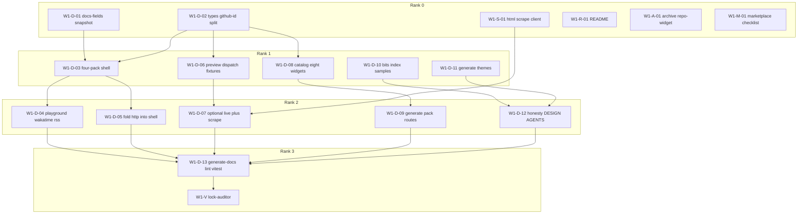

# Plan: e2e-refine

Parent DAG for `goals/e2e-refine/`. Workstream prose is in `plans/*.md`. Nits in `backlog.md`. Runtime fan-out is `.grok/workflows/e2e-refine.rhai` (user-level copy is the runnable one until project `.grok/workflows/` is trusted).

## Critique of the coarse plan

The first `plan.md` was one agent per workstream. That under-uses fan-out and hides file locks:

- Docs OpenSpec tasks 1.1–5.2 are **exclusive** but not all on the same files. Contracts (`docs-fields.ts` vs `types.ts`) can start together; shell, preview, and catalog are separate trees after that.
- Wave 1 asked for live HTML scrape while the scrape client sat in wave 2 — a false dependency. Scrape is an integrations module with no dump coupling; it moves to **wave 1 rank 0**.
- Each widen is five sequential slices (spec, payload, endpoints, fixtures, widget reader) that must not run as one blob, but the **four sources** stay parallel.
- Wave 3 packs share bits (`Image`, `Heatmap`, `Board`). Bits are a barrier; packs are a parallel panel. Intra-pack OpenSpec → types → client → plugin → widgets is a pipeline, not a single agent.
- Missing: read-only lock-auditor panels after each rank (never unauth GitHub, no REST `/languages`, no `plugin_*_*_*`, no Playwright in Action, no `v1` on `main`).

## Parallelism rules

1. **Same-file writers are sequential.** Different files → parallel.
2. **One implementer per node** writes code **and** the tests for that node (avoids two writers on the same test file).
3. **Read-only critics** run in parallel with nothing that mutates their targets, or after a rank barrier.
4. **OpenSpec-first** for new ids. Completing `docs-full-catalog-playground` and leftover `marketplace-release` does **not** rewrite those change ids.
5. **Wave 2 does not `author-integration add`** on github/wakatime/rss/http (`client.ts` exists). Wave 3 **does** `add` only when dest `client.ts` is absent.
6. Max useful panel: all nodes in a rank. Workflow `args.wave` = `1|2|3|all`; `args.rank` optional to rerun one barrier.

## File locks (do not dual-write)

| Lock | Owners |
| --- | --- |
| `packages/core/src/codegen/docs-fields.ts` + snapshot | W1-D-01 only |
| `apps/docs/src/preview/types.ts` | W1-D-02 only |
| `apps/docs/src/codegen/shell.tsx`, `export-workflow.ts`, `schema-form.tsx` | W1-D-03 |
| `apps/docs/app/playground/**` routes | W1-D-04, W1-D-05 (split: new `wakatime/`+`rss/` vs `http/` fold) |
| `apps/docs/src/preview/server/render-preview.ts`, `app/api/preview/route.ts` | W1-D-06 then W1-D-07 |
| `apps/docs/app/generate/**` | W1-D-08, W1-D-09, W1-D-10, W1-D-11 (split catalog / pack routes / bits / themes) |
| `DESIGN.md`, `apps/docs/AGENTS.md` | W1-D-12 |
| `README.md` | W1-R-01 |
| `packages/core/src/types.ts` `ActionInputsSchema` | W2-A-03 (wave 3 types appends widget/plugin ids **after** W2-A, different keys — serialize if both dirty) |
| `packages/integrations/src/github/**` | W2-G-* pipeline |
| `packages/integrations/src/wakatime/**` | W2-WK-* |
| `packages/integrations/src/rss/**` | W2-RSS-* |
| `packages/integrations/src/http/**` | W2-HTTP-* |
| `packages/bits/src/<Name>.tsx` | one bit node each after W3-B-01 |
| `packages/plugins/src/<pack>/**` | that pack’s pipeline |

## Task graph

Node columns: **id**, **rank**, **deps**, **files**, **verify**, **detail**.

Ranks are barriers. All nodes that share a rank and have satisfied deps run in **one `parallel()`**.

### Wave 1 — docs / README / scrape / operator

Move HTML scrape here so preview live-scrape is not blocked on dumps.



| id | rank | deps | files | verify | what |
| --- | ---: | --- | --- | --- | --- |
| W1-D-01 | 0 | — | `docs-fields.ts`, `playground-fields.json`, `docs-fields.test.ts` | `just generate-docs --check` | Groups `coding`,`feed`,`json`,`chips`; omit tokens |
| W1-D-02 | 0 | — | `types.ts`, github `page.tsx` callers that import the union | types tests; github routes use `PREVIEW_GITHUB_WIDGET_IDS` only | Stop dumping eight ids onto github playground |
| W1-S-01 | 0 | — | new `packages/integrations/src/html-scrape/` | SSRF tests; no Playwright dep in action graph | https GET+parse, fixtures, 1 MiB |
| W1-R-01 | 0 | — | `README.md` | grep `@v1`; no `docs/assets/readme/`; eight stills | `output_pair` = selected flavor |
| W1-A-01 | 0 | — | `openspec/changes/add-github-repo-widget` | status `--json`; archive/sync | 28/28 complete |
| W1-M-01 | 0 | — | operator notes only | checklist in workstream | listing stills, `release.yml` dispatch, live pin |
| W1-D-03 | 1 | D-01, D-02 | `shell.tsx`, `schema-form.tsx`, `export-workflow.ts` | selector has four packs; yaml `plugins.<pack>` | Shared PlaygroundShell |
| W1-D-06 | 1 | D-02 | `render-preview.ts`, `route.ts` | POST dispatches four new widgets; GET 405; POST omits tokens | Fixtures default; never unauth GitHub |
| W1-D-08 | 1 | D-02 | `app/generate/catalog`, `widgets` | catalog lists 4 packs / 8 widgets | Do not index `githubWidgetRegistry` for `coding` |
| W1-D-10 | 1 | D-02 | `app/generate/bits` | samples not names-only | |
| W1-D-11 | 1 | D-02 | `app/generate/themes` | 47 `NAMED_THEME_IDS` | no new palette family |
| W1-D-04 | 2 | D-03 | `app/playground/wakatime`, `rss` | routes exist; landing source still has no those paths | |
| W1-D-05 | 2 | D-03 | `app/playground/http` | json+chips tuners in shell | keep URL |
| W1-D-07 | 2 | D-06, S-01 | `render-preview.ts` live branch | App token / WakaTime env / SSRF URL / HTML scrape; still not embed API | |
| W1-D-09 | 2 | D-08 | `app/generate/{wakatime,rss,http}` | pack `bitsUsed` | |
| W1-D-12 | 2 | D-04, D-05, D-08, D-10, D-11 | `DESIGN.md`, `apps/docs/AGENTS.md` | four-pack honesty; preview ≠ embed | |
| W1-D-13 | 3 | D-04…D-12, R-01 | CI recipes | `just lint`; docs+core vitest; `generate-docs --check`; `generate-action --check` | |
| W1-V | 3 | D-13 | read-only | grep locks | see Lock-auditor |

### Wave 2 — auth schemes + four dumps

Intra-source pipeline (spec → payload → extra endpoints → fixtures → widget reader → tests). **Sources parallel.** Auth scheme types before Spotify/Steam (wave 3), not before dumps.

```mermaid
flowchart TD
  subgraph a [Auth rank 0-1]
    A01[W2-A-01 oauth-refresh spec]
    A02[W2-A-02 query-key spec]
    A03[W2-A-03 ActionInputs plus yaml token_env]
    A04[W2-A-04 generate-action --check]
  end
  A01 --> A03
  A02 --> A03
  A03 --> A04
  subgraph g [github]
    G1[W2-G-01 spec] --> G2[W2-G-02 payload types]
    G2 --> G3[W2-G-03 extra endpoints]
    G2 --> G4[W2-G-04 fixtures]
    G3 --> G5[W2-G-05 widget readers]
    G4 --> G5
    G5 --> G6[W2-G-06 tests]
  end
  subgraph wk [wakatime]
    WK1 --> WK2 --> WK3
    WK2 --> WK4
    WK3 --> WK5
    WK4 --> WK5 --> WK6
  end
  subgraph rss [rss]
    R1 --> R2 --> R3
    R2 --> R4
    R3 --> R5
    R4 --> R5 --> R6
  end
  subgraph http [http]
    H1 --> H2 --> H3
    H2 --> H4
    H3 --> H5
    H4 --> H5 --> H6
  end
```



| id | rank* | deps | what / verify |
| --- | --- | --- | --- |
| W2-A-01 | A0 | — | OpenSpec `oauth-refresh` (Spotify). author-integration currently **stops** on oauth2 |
| W2-A-02 | A0 | — | OpenSpec `query-key` (`?key=`). Bearer cannot send Steam keys |
| W2-A-03 | A1 | A-01, A-02 | `ActionInputsSchema` optional `*_token` (no default) + yaml `token_env`. No flatten, no extra pack bools |
| W2-A-04 | A2 | A-03 | `pnpm generate-action --check`; schema keys ≡ `action.yml` |
| W2-G-01…06 | G0–G5 | chain | Typed dump of **already fetched** REST/GraphQL JSON; optional extra auth’d endpoints; **never** REST `/languages`; cap 500; empty token `fail_job`; widgets select |
| W2-WK-01…06 | same | chain | Full stats `data` in cache (`percent`,`best_day`,`categories`,`machines`,…); extra `all_time_since_today`, summaries, today, goals; include/limit **widget-side**; Basic auth; no email/key in model |
| W2-RSS-01…06 | same | chain | Feed+item dump; leftover triple is the **feed widget**; SSRF/1MiB/no GitHub hosts stay |
| W2-HTTP-01…06 | same | chain | json remains full JSON; chips cache raw `{label,message,color,name,value,link}`; chips GET `auth: none` |
| W2-V | after all | dumps + A-04 | lock-auditor + `just lint` + targeted vitest |

\*Github/wakatime/rss/http ranks are **independent clocks**. The workflow launches four pipelines in one phase; each pipeline is sequential internally (6 agents × 4 = 24, plus 4 auth + 1 critic).

### Wave 3 — bits barrier, then parallel packs

Elbow **N = 4**: `spotify`, `leetcode`, `chess`, `steam` ([inventory](inventory/integrations-elbow.md)). Rank 5+ in `backlog.md`.

| id | rank | deps | what |
| --- | ---: | --- | --- |
| W3-B-01 | 0 | — | One OpenSpec change naming Image, Heatmap, Board, Icon, Grid, List, Time. Frozen 11 untouched. Refuse Dialog/Toast/Popover/Dropdown/Command |
| W3-B-02…08 | 1 | B-01 | **One agent per bit file** (7-way parallel) |
| W3-B-09 | 2 | B-02…08 | Barrel `BIT_EXPORTS` + `index.test.ts` |
| W3-B-10 | 2 | B-02…08 | `/generate/bits` samples |
| W3-GR-01 | 3 | B-09, W2-G-06 | github `top-repos` from owner crawl |
| W3-GR-02 | 3 | B-09, W2-G-06 | github contribution heatmap widget (same integration) |
| W3-WK-01 | 3 | B-09, W2-WK-06 | wakatime slice cards (new widget ids, not `stats`) |
| W3-RS-01 | 3 | B-09, W2-RSS-06 | rss `latest` + Time bit |
| W3-SP-01…05 | 3–7 | B-09, W2-A-04 | OpenSpec → `author-integration add spotify` → plugin → `now-playing`/`top` → tests. oauth-refresh; `spotify_token`; client id/secret env not yaml |
| W3-LC-01…05 | 3–7 | B-09 | leetcode GraphQL POST, auth none, `solved`+`heatmap`; CF 403 → `fail_widget`; HTML scrape only as SSRF fallback |
| W3-CH-01…06 | 3–7 | B-09 | chess pack + `chesscom` + `lichess`; widgets `ratings`,`game`; no widget id `stats` |
| W3-ST-01…05 | 3–7 | B-09, W2-A-04 | steam `?key=`; `steam_token`; `player`,`recent` |
| W3-V | last | all packs | lock-auditor; `just lint`; `generate-action --check`; `generate-docs --check`; vitest |

Pack pipelines are **four parallel teams**. Do not start SP/ST before W2-A-04. Chess.com vs lichess default when yaml only has `user`: chess.com first (README meme), lichess fallback — not a blocker.

Call order for a **new** source: OpenSpec → `/author ideate` → `author-integration add <id>` → `author-plugin` → `author-widget` → `author-bit` only if B-01 already approved the primitive.

## Lock-auditor (every `*-V` node, read-only, parallelizable checks)

Run as one agent with this grep list, or fan out one check per item:

- no `plugin_<plugin>_<widget>_<option>`
- no `plugin_wakatime` / `plugin_rss` / `plugin_http` bools
- no unauthenticated GitHub (empty token still `fail_job`)
- no REST `/repos/{owner}/{repo}/languages`
- GraphQL `nodes(ids:)` batches of 100 remain
- no Playwright in `packages/action` / ncc graph
- GET `/api/preview` 405; POST omits token keys; copy says not an embed API
- never tag `v1` at `main`; `dist/` gitignored on `main`
- CLI `output_action` default `none`; Action default `commit`
- no `npx skills add`

## Subagent team shape

| Role | When | Tools |
| --- | --- | --- |
| Implementer | every graph node | read/write, tests for that node |
| Lock-auditor | `*-V` ranks | read-only grep |
| Design critic | after W1-D-03 and W1-D-12 | docs chrome vs DESIGN.md widget lock (Geist cards unchanged) |
| Schema completeness | after each W2-*-02 | payload fields vs inventory drop-list (data-wizard Completeness on fixtures, not ML) |

Do not run `npx skills add`. Do not dual-write `types.ts` across packs without a merge barrier (serialize FIRST_PARTY_* appends: one types-owner agent per rank that applies a patch list).

**`types.ts` fan-in:** Wave 3 new ids (spotify, leetcode, chess, steam, new widgets, new bits if enumerated in core) **must not** seven-way edit `packages/core/src/types.ts`. Rank 3 starts with **W3-T-01** (single types append) after B-01 and W2-A-04, then pack agents consume the enums. Add that node:

| id | rank | deps | what |
| --- | --- | --- | --- |
| W3-T-01 | 3 | B-01, W2-A-04 | Single commit to `FIRST_PARTY_*` + widget maps for elbow ids and reuse widgets. Pack agents do not touch this file |

Then SP/LC/CH/ST deps include W3-T-01.

## Workflow mapping

`.grok/workflows/e2e-refine.rhai`:

- `args.wave`: `1` `2` `3` `all`
- `args.rank`: optional rank label (`0`,`1`,`2`,`3`, `A0`, …) to rerun one barrier
- Each rank = `phase(title)` + `parallel([...implementer prompts...])`
- After the wave’s last rank: parallel lock-auditor
- One implementer prompt per **graph id**, not per workstream file
- Budget: wave 1 ≈ 16 logical agents; wave 2 ≈ 30; wave 3 ≈ 40. Stay under 128

Project path is not trusted in this Grok session; runnable copy is `~/.grok/workflows/e2e-refine.rhai`. Keep the in-repo file as SSOT and copy out to run.

## Cross-cutting verify

```bash
just lint
just generate-action --check
just generate-docs --check
pnpm exec vitest run
pnpm exec openspec status --change docs-full-catalog-playground --json
```

## Risks

- Dirty docs types already break freeze tests; W1-D-02 must update callers/tests, not revert four-pack ids.
- WakaTime/rss dumps need integration-contract **deltas**; leftover requirements become widget readers.
- LeetCode Cloudflare 403 from `ubuntu-latest`.
- Spotify client id/secret do not fit one Action token; named env only.
- `author-integration` has no widen mode — wave 2 is hand-extend.
- Marketplace 4.2/5.1/5.2 remain human (W1-M-01).
- Palettes: no new family unless a widget needs a missing flavor (N does not).

## Open (non-blocking)

- Promote `lastfm` from backlog only if Spotify OAuth is deferred.
- GitHub streak as extra **github** widget after Heatmap — already W3-GR-02, not a new integration.
